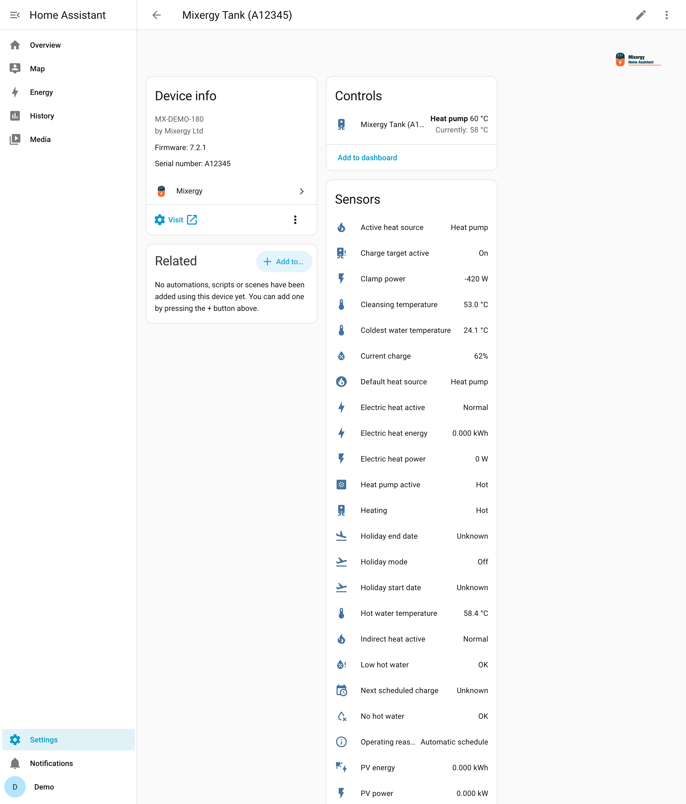
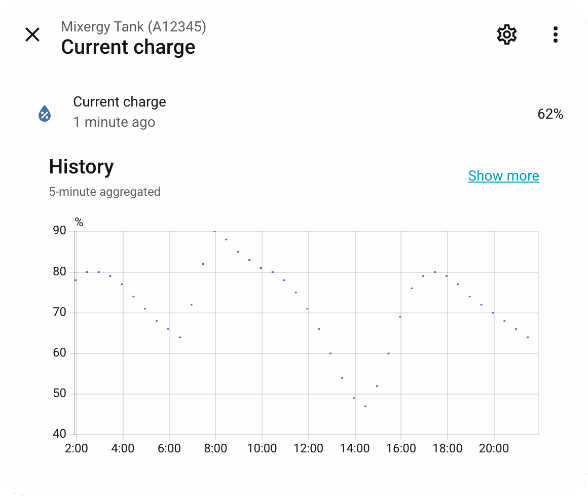
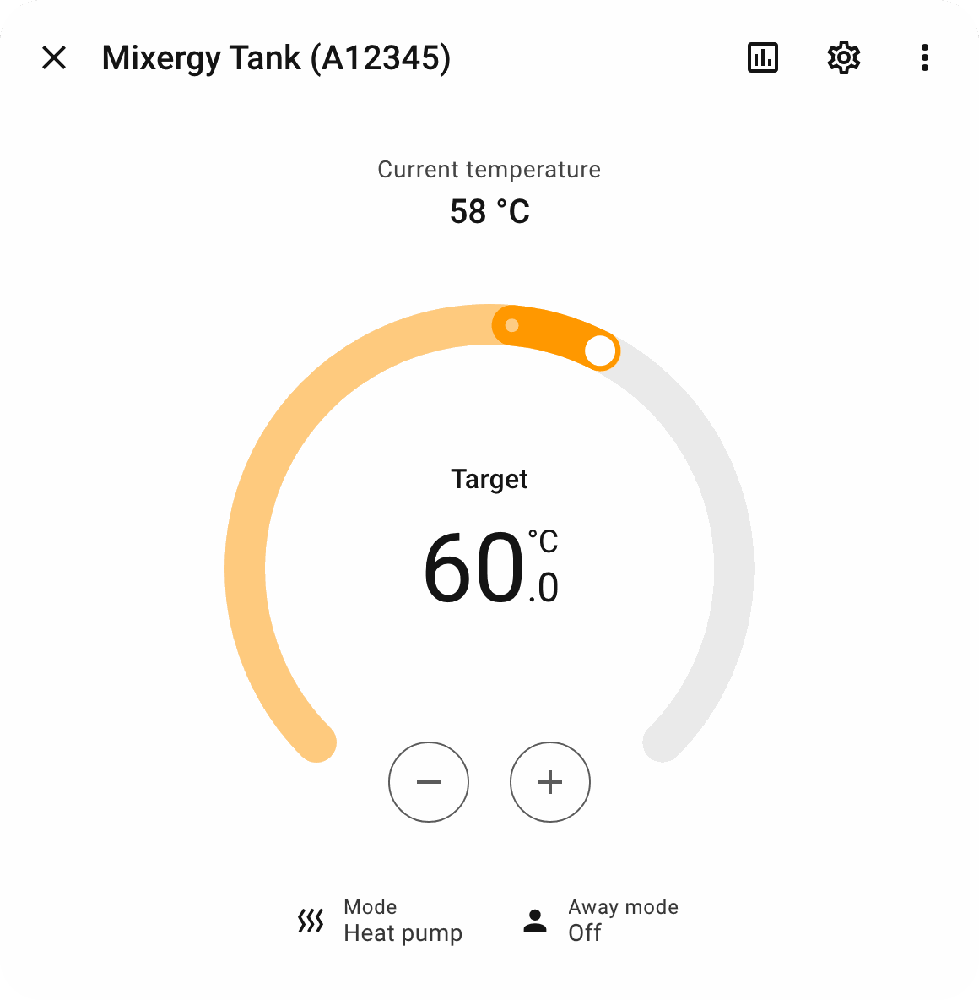
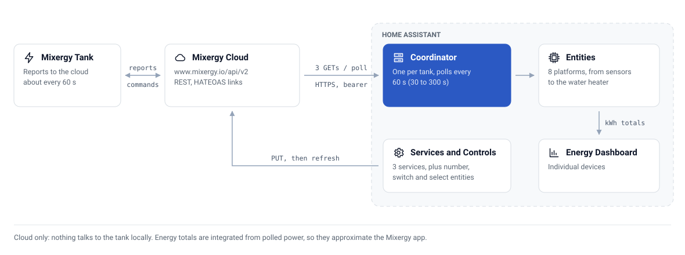

<div align="center">


# ♨️ Mixergy for Home Assistant

**See how much hot water is left in your Mixergy tank and heat it when you choose, from Home Assistant, with no YAML and one HACS install**


[](https://hacs.xyz)
[](https://github.com/CaputoDavide93/Mixergy-Home-Assistant/releases)

[](https://github.com/CaputoDavide93/Mixergy-Home-Assistant/actions/workflows/tests.yaml)

</div>

---

## 💡 Why it exists

A Mixergy tank knows how full it is, what temperature the top and bottom are, and which heat source is running. That information stays in Mixergy's app. Your automations, your dashboards and your Energy dashboard cannot see it, and a boost before a house full of guests means opening another app.

This integration puts the tank in Home Assistant. You get the charge and temperatures as sensors, a boost you can call from an automation or a voice assistant, kWh totals for the Energy dashboard, and holiday scheduling. You set it up in the UI with the account you already use in the Mixergy app.

| | This integration | Mixergy's own app | Hand-written REST sensors |
|---|---|---|---|
| Charge and temperatures as Home Assistant sensors | Yes | No | Yes, once you write them |
| Boost from an automation or voice assistant | Yes | No | Only what you build |
| Energy dashboard kWh sensor | Yes | No | You write the integration of power into energy |
| Sign-in, token renewal and API link checks | Handled for you | Handled by the app | You write them |
| Setup | Guided, in the UI | n/a | YAML and secrets |
| Works without internet | No | n/a | No |

The one trade-off: the tank has no local API, so every reading goes through Mixergy's cloud. No internet or no Mixergy service means no data, and updates arrive every 30 to 300 seconds (60 by default).

---

## 🚀 Install in 3 steps

You need Home Assistant 2025.8 or newer, [HACS](https://hacs.xyz/), and the email address and password of your Mixergy app account.

1. **Install with HACS.** Add `https://github.com/CaputoDavide93/Mixergy-Home-Assistant` as a custom repository of type **Integration**, download **Mixergy**, restart Home Assistant.
2. **Add the integration.** **Settings → Devices & services → Add integration → Mixergy**, sign in and pick your tank.
3. **Choose your mode.** **Simple** for monitoring and boost, **Advanced** for the full control surface. You can change it later from the Configure button.

[](https://my.home-assistant.io/redirect/hacs_repository/?owner=CaputoDavide93&repository=Mixergy-Home-Assistant&category=integration)

Every screen of the setup, with screenshots, is in [docs/setup.md](docs/setup.md). Manual install and the 1.x to 2.x migration are in [docs/installation.md](docs/installation.md).

> **The icon shows as a grey placeholder in HACS.** Nothing is wrong with your install. It is a [known HACS limitation](https://github.com/hacs/integration/issues/5171) for custom integrations published after February 2026, and the icon shows correctly inside Home Assistant. [More detail](docs/troubleshooting.md#why-is-the-icon-missing-in-hacs).

---

## ✨ Features

| | Feature | What it does |
|---|---|---|
| 🚿 | Know your hot water | Charge, top and bottom temperatures, target, active and default heat source, and why the tank is heating |
| ⚡ | One-tap boost | A slider to set how full you want the tank, and a `boost_charge` service for automations |
| 🔋 | Energy dashboard ready | Cumulative electric and PV kWh sensors, plus an optional cost sensor when you set a tariff |
| 🔔 | Alerts you can trust | Low and no hot water sensors with thresholds you set, a tank connectivity sensor, and device triggers for low water, heating start and stop, and holiday start and end |
| ☀️ | PV diverter controls | Cut-in threshold, charge limit, target current and over-temperature limit, when your tank has a diverter |
| 🌴 | Holiday scheduling | Date pickers, a clear button and services, with the tank's own weekly programme readable as a sensor |
| 🌡️ | Native water heater | In Advanced mode, one card with current and target temperature, heat source mode and an away toggle, for standard water heater cards and voice assistants |
| 🛁 | More than one tank | One device per tank, and services accept an entity, device or area target |
| 🩺 | Diagnostics | A download with credentials, tokens and the serial redacted, safe to attach to an issue |
| 🌍 | Four languages | English, German, French and Italian, with English as the fallback |

Every entity and service, generated from the code, is listed in [docs/entities.md](docs/entities.md).

### Simple or Advanced

| Mode | Who it is for | What you get |
| ---- | ------------- | ------------ |
| **Simple** | Most people | Every sensor and binary sensor, plus the Hot water boost slider |
| **Advanced** | Power users | Everything in Simple, plus the water heater, temperature and charge numbers, heat source select, PV settings, switches and holiday pickers |

The exact entities per mode are in [docs/configuration.md](docs/configuration.md#-simple-vs-advanced--what-does-each-mode-create).

### Supported and tested

| Setup | Status |
| ----- | ------ |
| Home Assistant 2025.8.0 (the minimum) | ✅ Test suite passes in CI |
| Home Assistant 2026.8.2 | ✅ Test suite passes in CI, and hassfest and HACS validation run on every pull request |
| One Mixergy tank with indirect (gas or oil) heating, firmware 7.2.1 | ✅ Run live by the maintainer |
| Electric immersion, heat pump and PV diverter tanks | ❔ Handled in code and covered by unit tests with sample responses, not run on hardware |
| Local control without the cloud | ❌ Not possible, the tank has no local API |

Running a different tank? Tell us what happened, see [Contributing](#-contributing). This is an independent project, not made or endorsed by Mixergy.

---

## 📸 Screenshots

Taken with `make screenshots` from a throwaway Home Assistant with a demo tank (serial `A12345`), so no real account or tank is shown. Every setup screen is in [docs/setup.md](docs/setup.md).

<picture>
  <source media="(prefers-color-scheme: dark)" srcset="docs/assets/screenshots/device-dark.png">
  
</picture>

<table>
<tr>
<td width="50%">

<picture>
  <source media="(prefers-color-scheme: dark)" srcset="docs/assets/screenshots/charge-history-dark.png">
  
</picture>

**Charge history** shows when the tank was drawn down and topped up.

</td>
<td width="50%">

<picture>
  <source media="(prefers-color-scheme: dark)" srcset="docs/assets/screenshots/water-heater-dark.png">
  
</picture>

**The water heater** sets the target temperature and heat source in Advanced mode.

</td>
</tr>
</table>

---

## 🗺️ Architecture

<picture>
  <source media="(prefers-color-scheme: dark)" srcset="docs/assets/architecture-dark.svg">
  
</picture>

One coordinator per tank polls the cloud with three parallel requests (measurement, settings, schedule). Services and controls send a `PUT` and then ask for an immediate refresh, so a change never waits for the next poll. How reads, writes, freshness and energy work is in [docs/how-it-works.md](docs/how-it-works.md), and the client internals are in [docs/api.md](docs/api.md).

---

## 🤖 Example automation

More recipes, including workday boosts, solar-surplus boosts and cheap-tariff windows, are in the [automations cookbook](docs/automations.md).

```yaml
automation:
  - alias: "Low hot water alert"
    triggers:
      - trigger: state
        entity_id: binary_sensor.mixergy_tank_<serial>_low_hot_water
        from: "off"
        to: "on"
    actions:
      - action: notify.mobile_app_your_phone
        data:
          title: "Low hot water"
          message: "Tank charge is below the low threshold, consider a boost."
```

Entity ids follow `sensor.mixergy_tank_<serial>_…`. Replace `<serial>` with your tank's serial number in lower case, or pick the entity in the UI.

---

## 🔒 Security

- TLS with certificate verification on every API call, and a 30 second request timeout.
- Bearer token renewed five minutes before expiry.
- Discovered API links are validated: the client refuses to send the token to a non-HTTPS or non-Mixergy host.
- Credentials live in Home Assistant's config entry and never reach logs or diagnostics.
- Non-admin users need control permission on the tank a service targets.

To report a vulnerability privately, see [SECURITY.md](SECURITY.md). The built-in quality assessment, rule by rule, is in [`quality_scale.yaml`](custom_components/mixergy_tank/quality_scale.yaml).

---

## 📁 Repo structure

```text
Mixergy-Home-Assistant/
├── custom_components/
│   └── mixergy_tank/        # 🏠 the integration, HACS installs this folder
│       ├── brand/           # 🎨 packaged icon and logos
│       └── translations/    # 🌍 de, en, fr, it
├── tests/                   # 🧪 pytest suite, 95% coverage floor
├── tools/
│   ├── gen_entity_docs.py   # 🤖 regenerates the entity tables in docs/entities.md
│   ├── gen_diagram.py       # 🗺️ draws the architecture SVGs
│   └── screenshots/         # 📸 throwaway Home Assistant and demo tank for make screenshots
├── docs/                    # 📚 guides, index in docs/README.md
│   └── assets/              # 🖼️ diagrams, screenshots, brand sources, banner, social preview
├── .github/                 # ⚙️ hassfest, HACS validation, tests, templates, Dependabot
├── .gitignore
├── Makefile                 # 🔧 make check, make screenshots
├── hacs.json                # 🏠 HACS metadata
├── pyproject.toml           # ⚙️ pytest, ruff, mypy, coverage
├── requirements-test.txt    # 🧪 test and lint dependencies
├── llms.txt                 # 🤖 the project in one page for AI search
├── AGENTS.md
├── CHANGELOG.md
├── CLAUDE.md
├── CONTRIBUTING.md
├── SECURITY.md
└── LICENSE
```

---

## 🤝 Contributing

Reports from other tanks are the most useful contribution. If you run electric-only, heat pump or PV diverter hardware, open an [issue](https://github.com/CaputoDavide93/Mixergy-Home-Assistant/issues) with the heating type, the firmware version, your Home Assistant version and the **Download diagnostics** file (credentials and serial are redacted). The exact list is in [CONTRIBUTING.md](CONTRIBUTING.md#reporting-untested-hardware).

For code, `make check` runs what CI runs: ruff, mypy, the tests and both generators.

**Debug logging**, if a fault comes and goes: add this to `configuration.yaml` and restart.

```yaml
logger:
  default: warning
  logs:
    custom_components.mixergy_tank: debug
```

More in [docs/troubleshooting.md](docs/troubleshooting.md), and short answers in the [FAQ](docs/faq.md).

---

## 📄 License

This project is licensed under the [MIT License](LICENSE).

---

<p align="center"><sub>Made with ❤️ by <a href="https://github.com/CaputoDavide93">Davide Caputo</a></sub></p>
