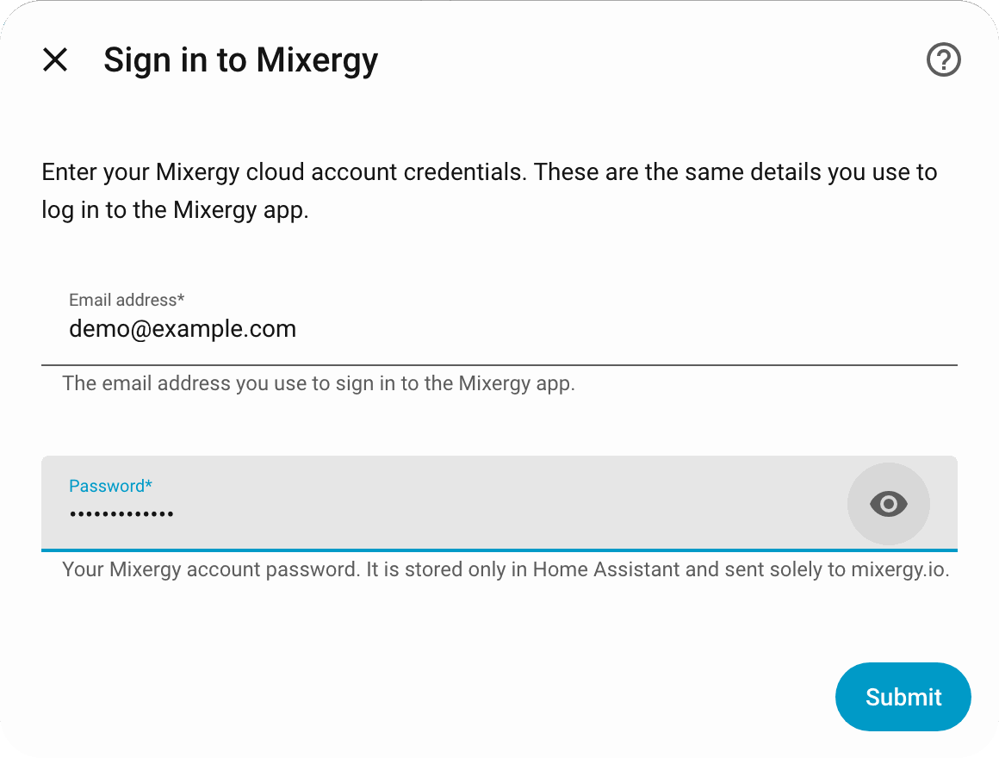
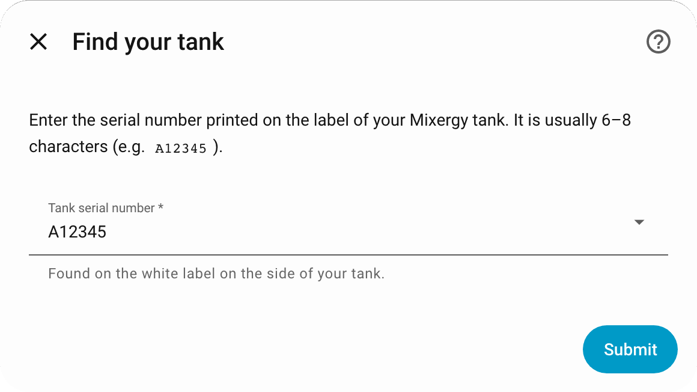
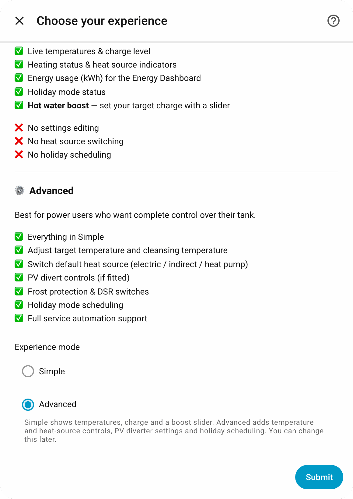

# 🧭 Setup

A numbered walkthrough from nothing to a working tank in Home Assistant. It takes about five minutes. The screenshots are taken from a throwaway Home Assistant with a demo tank (serial `A12345`), so no real account or tank appears in them. Every option is described in [configuration.md](configuration.md).

## Before you start

- Home Assistant 2025.8 or newer, with [HACS](https://hacs.xyz/) installed.
- The email address and password you use in the Mixergy app.
- Outbound HTTPS from Home Assistant to `www.mixergy.io`. The integration has no local connection to the tank.
- Upgrading from a 1.x release? Do the [1.x to 2.x migration](installation.md#upgrading-from-1x-to-2x) first.

## 1. Add the repository to HACS

1. Open HACS in Home Assistant.
2. Open the three-dot menu, choose **Custom repositories**, and add `https://github.com/CaputoDavide93/Mixergy-Home-Assistant` with category **Integration**.
3. Search for **Mixergy**, check the owner is `CaputoDavide93`, and download it.
4. Restart Home Assistant.

The badge in the [README](../README.md) opens the repository in your instance directly. No HACS? [Install by hand](installation.md#-manual-installation).

## 2. Sign in to Mixergy

Go to **Settings → Devices & services → Add integration**, search for **Mixergy**, and enter your Mixergy app email address and password. The integration checks them against the Mixergy cloud before it lets you continue.

<picture>
  <source media="(prefers-color-scheme: dark)" srcset="assets/screenshots/setup-credentials-dark.png">
  
</picture>

A wrong password shows **Invalid email address or password** and keeps you on this screen. A network problem shows **Unable to connect to the Mixergy API**. See [troubleshooting.md](troubleshooting.md#setup-problems).

## 3. Pick your tank

The integration lists the tanks on your account. Choose yours, or type the serial number printed on the label on the side of the tank.

<picture>
  <source media="(prefers-color-scheme: dark)" srcset="assets/screenshots/setup-tank-dark.png">
  
</picture>

The serial is upper-cased for you. If the dropdown does not appear, the integration could not list your tanks and shows a plain text field instead.

## 4. Choose Simple or Advanced

**Simple** gives you every sensor and a hot water boost slider. **Advanced** adds the water heater entity, temperature and charge controls, heat source selection, PV diverter settings, switches and holiday pickers. You can switch later from the integration's **Configure** button.

<picture>
  <source media="(prefers-color-scheme: dark)" srcset="assets/screenshots/setup-mode-dark.png">
  
</picture>

## 5. Find your tank in Home Assistant

The tank is one device named `Mixergy Tank (<serial>)`. Open it from **Settings → Devices & services → Mixergy**. This is the demo tank in Advanced mode.

<picture>
  <source media="(prefers-color-scheme: dark)" srcset="assets/screenshots/device-dark.png">
  
</picture>

Open **Current charge** to see its history, and the water heater entity to set the target temperature.

<picture>
  <source media="(prefers-color-scheme: dark)" srcset="assets/screenshots/charge-history-dark.png">
  
</picture>

<picture>
  <source media="(prefers-color-scheme: dark)" srcset="assets/screenshots/water-heater-dark.png">
  
</picture>

## 6. Add it to the Energy dashboard (optional)

Under **Settings → Dashboards → Energy → Individual devices**, add **Electric heat energy**. The [energy guide](energy.md) explains PV energy and the optional cost sensor.

## Next steps

- Try a recipe from the [automations cookbook](automations.md).
- Something not showing? [Troubleshooting](troubleshooting.md).
- Retake these screenshots yourself: `make screenshots` (see [CONTRIBUTING.md](../CONTRIBUTING.md)).
